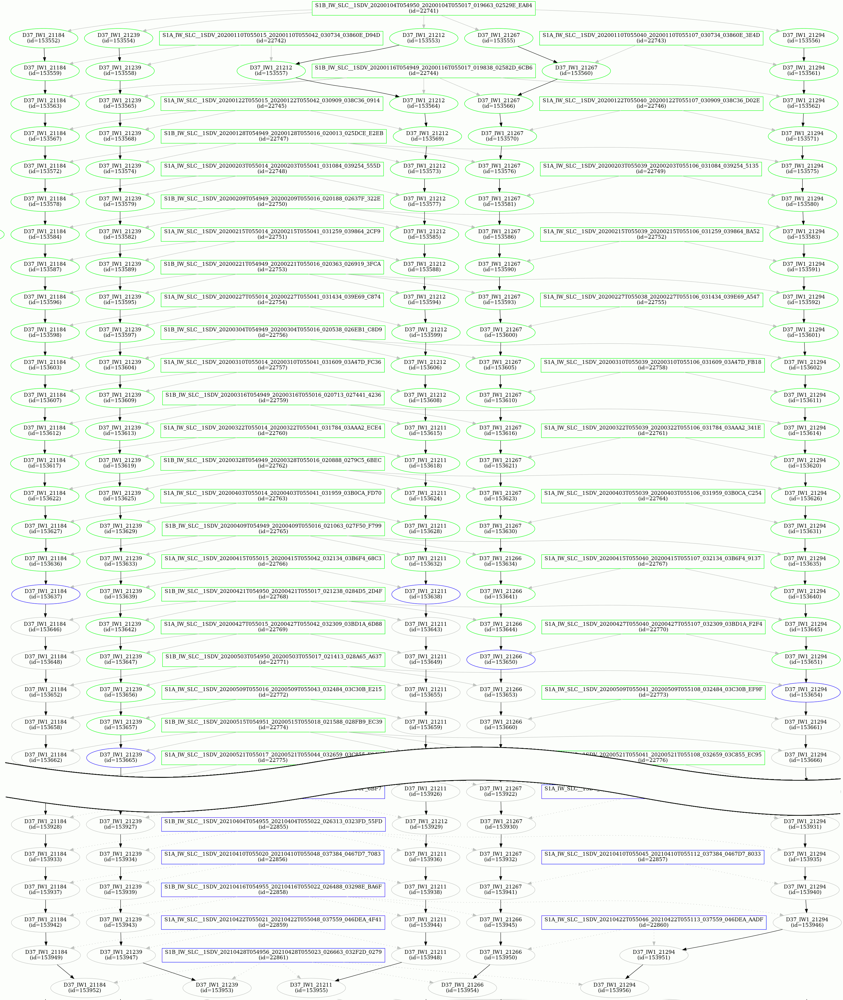

# Monitoring

To monitor an ingestion, the workflow server provides several endpoints.

## Endpoints

### Health Check

- `GET /`: Health check endpoint, returns "ingester ok"

### AOI

- `GET /aoi/`: List all the AOIs
- `POST /aoi/{aoi}`: Create a new AOI
- `GET /aoi/{aoi}`: Overview of the workload for an AOI
- `DELETE /aoi/{aoi}`: Delete an AOI and all its associated scenes and tiles
- `POST /aoi/{aoi}/scene`: Add a new scene and its tiles to the graph of dependencies
- `PUT /aoi/{aoi}/retry`: Retry all the scenes and tiles of the AOI (only if Status=RETRY)
- `PUT /aoi/{aoi}/retry/force`: Retry all the scenes and tiles of the AOI (force retry regardless of status)
- `PUT /aoi/{aoi}/fail`: Fail all the scenes and tiles of the AOI (only if Status=RETRY)
- `PUT /aoi/{aoi}/fail/force`: Fail all the scenes and tiles of the AOI (force fail regardless of status)
- `GET /aoi/{aoi}/scenes`: List all scenes of an AOI
- `GET /aoi/{aoi}/scenes/{status}`: List scenes of an AOI filtered by status
- `GET /aoi/{aoi}/tiles/{status}`: List tiles of an AOI filtered by status
- `GET /aoi/{aoi}/dot`: Pretty display of the workflow as a DOT graph
- `GET /aoi/{aoi}/roottiles`: List root tiles of an AOI
- `GET /aoi/{aoi}/leaftiles`: List leaf tiles of an AOI

Example output for `GET /aoi/{aoi}`:

```
Scenes:
  new:     0
  pending: 10
  done:    36
  retry:   0
  failed:  0
  Total:   46
Tiles:
  new:     10
  pending: 21
  done:    15
  retry:   0
  failed:  0
  Total:   46

Root tiles : 46
  From: 2022-01-04
  To:   2022-10-12
```

Example DOT graph output:



### Scenes

Scene endpoints return data in GeoJSON Format, containing geometry, product tags, and payload information.

- `GET /aoi/{aoi}/scenes`: List scenes of an AOI

Ex:

```json
[
    {
        "id": 12,
        "source_id": "S2A_MSIL1C_20220104T103431_N0301_R108_T32UNG_20220104T123507",
        "aoi": "DenmarkDemoS2",
        "data": {
            "uuid": "4c0e52b5-c96d-5bfc-b0f0-c78ed9c50d48",
            "date": "2022-01-04T10:34:31.024Z",
            "tiles": {
                "S2A_MSIL1C_20220104T103431_N0301_R108_T32UNG_20220104T123507": {
                    "swath_id": "",
                    "tile_nr": 0
                }
            },
            "graph_name": "CopyProductToStorage",
            "graph_config": {},
            "record_id": "ea343a2a-4189-466c-9519-eb38b908ab13",
            "instances_id": {
                "B01": "7b2cb808-a021-4de1-8703-716824fc23d8",
                "B02": "7b750eec-692a-45d0-ada9-92beb26e9f60",
                "B03": "7044c9d4-547e-4f22-8eeb-d6fbecc8b764",
                "B04": "cdce88a6-32b4-4b1e-af5e-c1e2f274cf2e",
                "B05": "b902d419-56d2-461e-b436-a8248cd10ff1",
                "B06": "82187d20-b58c-4324-a113-7b8ebd1b8cf7",
                "B07": "10c6f347-ed88-45ab-8c05-e434167d31f2",
                "B08": "23e10257-4d57-4094-b96e-ecc484671f68",
                "B09": "4274efb4-f2c4-4132-9905-a8f9d6accad1",
                "B10": "5eb73278-ce79-4374-a5c7-77c269f8e6e1",
                "B11": "f910e281-f870-487e-9b58-a8768ef1ba07",
                "B12": "613094ff-a87e-4107-bb29-a84f05ccea88"
            },
            "metadata": null,
            "is_retriable": true,
            "storage_uri": ""
        },
        "status": "DONE",
        "message": "",
        "RetryCountDown": -1
    },
    {
        "id": 14,
        "source_id": "S2B_MSIL1C_20220112T104319_N0510_R008_T32UNG_20240428T024837",
        "aoi": "DenmarkDemoS2",
        "data": {
            "uuid": "d16f8a29-cabc-48c2-a569-3a3d633dc2c4",
            "date": "2022-01-12T10:43:19Z",
            "tiles": {
                "S2B_MSIL1C_20220112T104319_N0510_R008_T32UNG_20240428T024837": {
                    "swath_id": "",
                    "tile_nr": 0
                }
            },
            "graph_name": "CopyProductToStorage",
            "graph_config": {},
            "record_id": "70439ab1-b2c8-433a-a3ff-f5dfa0249c11",
            "instances_id": {
                "B01": "7b2cb808-a021-4de1-8703-716824fc23d8",
                "B02": "7b750eec-692a-45d0-ada9-92beb26e9f60",
                "B03": "7044c9d4-547e-4f22-8eeb-d6fbecc8b764",
                "B04": "cdce88a6-32b4-4b1e-af5e-c1e2f274cf2e",
                "B05": "b902d419-56d2-461e-b436-a8248cd10ff1",
                "B06": "82187d20-b58c-4324-a113-7b8ebd1b8cf7",
                "B07": "10c6f347-ed88-45ab-8c05-e434167d31f2",
                "B08": "23e10257-4d57-4094-b96e-ecc484671f68",
                "B09": "4274efb4-f2c4-4132-9905-a8f9d6accad1",
                "B10": "5eb73278-ce79-4374-a5c7-77c269f8e6e1",
                "B11": "f910e281-f870-487e-9b58-a8768ef1ba07",
                "B12": "613094ff-a87e-4107-bb29-a84f05ccea88"
            },
            "metadata": null,
            "is_retriable": true,
            "storage_uri": ""
        },
        "status": "FAILED",
        "message": "ProcessScene.ImageProviders.URLImageProvider: unable to retrieve download Link: scene metadata is empty\n Product not found or unavailable: ...",
        "RetryCountDown": -1
    }
]
```

- `GET /aoi/{aoi}/scenes/{status}`: Get scenes of an AOI filtered by status
- `GET /scene/{scene}`: Get scene using its id
- `GET /scene/{scene}/tiles`: Get tiles of a scene (GeoJSON Format)

- `PUT /scene/{scene}/data`: Update scene data
- `PUT /scene/{scene}/retry`: Retry the scene (only if scene.Status=RETRY)
- `PUT /scene/{scene}/fail`: Tag the scene and all its tiles as failed and update the graph of dependencies (only if scene.Status=RETRY if /force is not stated)
- `PUT /scene/{scene}/force/{status}`: Force set scene status to specified status

### Tiles

Tile endpoints return data in GeoJSON Format, containing geometry, product tags, and payload information.

- `GET /scene/{scene}/tiles`: Get tiles of a scene

Ex:

```json
[
    {
        "id": 12,
        "source_id": "S2A_MSIL1C_20220104T103431_N0301_R108_T32UNG_20220104T123507",
        "scene": {
            "id": 12,
            "source_id": "",
            "aoi": "",
            "data": {
                "uuid": "",
                "date": "0001-01-01T00:00:00Z",
                "graph_name": "",
                "graph_config": null,
                "record_id": "",
                "metadata": null,
                "is_retriable": false,
                "storage_uri": ""
            }
        },
        "data": {
            "swath_id": "",
            "tile_nr": 0,
            "graph_name": "library/graph/ExtractS2Bands.json",
            "is_retriable": true
        },
        "status": "RETRY",
        "message": "ProcessTile[20220104_S2A_MSIL1C_20220104T103431_N0301_R108_T32UNG_20220104T123507].LoadGraphFromFile.stat library/graph/ExtractS2Bands.json: no such file or directory\n badly formatted storage uri",
        "PreviousID": null,
        "ReferenceID": null,
        "RetryCountDown": -1
    }
]
```

- `GET /tile/{tile}`: Get tile using id
- `GET /aoi/{aoi}/tiles/{status}`: Get tiles of an AOI filtered by status

- `PUT /tile/{tile}/data`: Update tile data
- `PUT /tile/{tile}/retry`: Retry the tile (only if tile.Status=RETRY)
- `PUT /tile/{tile}/fail`: Tag the tile as failed and update the graph of dependencies (only if tile.Status=RETRY if /force is not stated)
- `PUT /tile/{tile}/force/{status}`: Force set tile status to specified status


## User-interface
A very ugly, but useful HTML interface can be found here [tools/workflow/main.html](https://github.com/airbusgeo/geocube-ingester/blob/main/tools/workflow/html/main.html).

